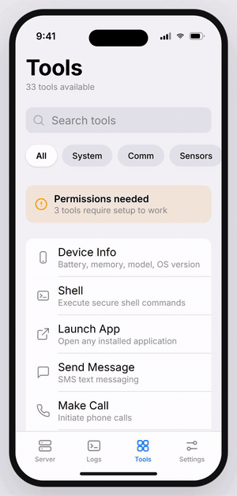
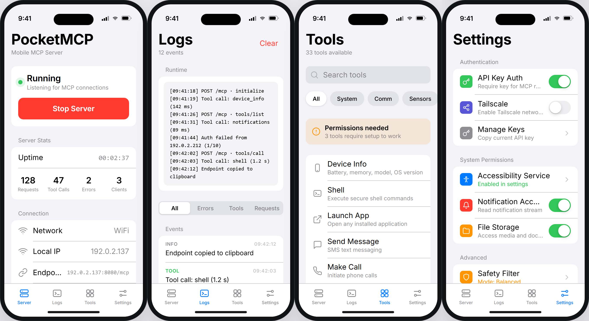
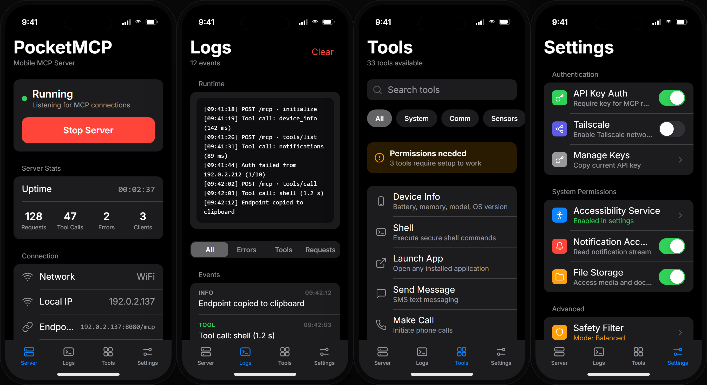

# PocketMCP

[](https://github.com/axonixtools/PocketMCP/actions/workflows/ci.yml)

Turn your Android phone into an MCP (Model Context Protocol) server.
AI agents and desktop scripts can call your phone for live data and actions over LAN or Tailscale.

## Demo

Tab switching, staggered content reveals, log filters, the sliding segmented control, category chips, and dark mode — captured from the live UI:

<p align="center">
  
</p>

<p align="center">
  <a href="docs/demo.mp4">▶ Watch the full-resolution walkthrough (MP4 · 736×1540 · 18s)</a>
</p>

## Download (Testing Pre-release)

- **Latest debug build:** [`PocketMCP-debug.apk`](./PocketMCP-debug.apk) (v1.0.0-beta.8) — install over USB with `adb install -r PocketMCP-debug.apk`
- **In-app updates:** after the first manual install, new builds are installed from Settings → App Updates (checks a JSON manifest and hands the APK to the system installer). The MCP server auto-resumes after each update.
- Previous tagged release: [v1.0.0-beta.1](https://github.com/axonixtools/PocketMCP/releases/tag/v1.0.0-beta.1)
- This build is marked as pre-release and may contain bugs while active development continues.

## Screenshots

<p align="center">
  
</p>

<p align="center"><em>Light mode — Server · Logs · Tools · Settings</em></p>

<p align="center">
  
</p>

<p align="center"><em>Dark mode — the app follows the system light/dark setting</em></p>

## Open-Source Commitment

PocketMCP is fully open-source and core functionality is free.
The project is MIT-licensed and community contributions are welcome.

## Why this is useful

**High-value use cases for all users:**

1. **Communication Hub**: Send WhatsApp, Instagram, Messenger messages and make calls from desktop
2. **Social Media Automation**: Interact with Instagram, YouTube, X/Twitter automatically
3. **Notification Management**: Monitor and respond to all phone notifications in real-time
4. **Daily readiness check**: "What is my battery and where is my phone right now?"
5. **Contact lookup**: "Find Alice's number from my phone contacts."
6. **App ecosystem control**: Launch and manage 309+ installed applications
7. **Phone diagnostics**: Run safe shell checks without unlocking the phone.

## Built-in tools

| Tool                  | Description                                                       |
| --------------------- | ----------------------------------------------------------------- |
| `device_info`         | Battery, model, OS, network, memory                               |
| `get_location`        | Best recent location from device providers                        |
| `search_contacts`     | Search contacts by name                                           |
| `make_call`           | Make phone calls to any number                                    |
| `send_message`        | Send messages via WhatsApp, Instagram, Messenger, Google Messages |
| `send_whatsapp_business_message` | Dedicated WhatsApp Business contact-safe sender      |
| `whatsapp_automation` | Advanced WhatsApp automation with accessibility control           |
| `social_media`        | Instagram, YouTube, X/Twitter interactions                        |
| `app_actions`         | JSON-preset actions for simpler app automation calls              |
| `notifications`       | Real-time notification monitoring and management                  |
| `shell`               | Run shell commands with safety filters and timeout                |
| `flashlight`          | Turn flashlight on/off/toggle and read state                      |
| `launch_app`          | Open an installed app by package or app name                      |
| `list_apps`           | List launchable installed apps (309+ apps detected)               |
| `global_action`       | Home/back/recents/notifications/quick settings/lock screen        |
| `scroll_screen`       | Scroll current app via accessibility gesture                      |
| `search_screen`       | Find search input on current screen and type query safely         |
| `tap`                 | Tap by visible text/content description or screen coordinates     |
| `volume_control`      | Read and change stream volume levels                              |
| `phone_alert`         | Ring and/or vibrate phone to help locate it quickly               |
| `voice_record`        | Record voice notes from microphone                                |
| `transcribe_audio`    | Speech-to-text from microphone or local audio file path          |
| `transcribe_file`     | Direct audio-file transcription by path                           |
| `transcribe_whatsapp_audio` | Transcribe latest WhatsApp/WhatsApp Business voice note     |
| `human_command`       | Natural-language command router across major tools                |
| `intelligent_action`  | Experimental humanoid planner/executor with retries and traces    |
| `http_request`        | Make outbound HTTP requests from phone                            |
| `read_file`           | Read files from allowed storage paths                             |

## 🆕 New Features (v.0+)

### 📞 **Phone Calling & Messaging**

- **Direct Calls**: Make phone calls to any number with contact name support
- **Multi-Platform Messaging**: WhatsApp, Instagram, Messenger, Google Messages
- **WhatsApp Business Support**: Prioritizes WhatsApp Business when installed
- **Deep Link Integration**: Opens apps with pre-filled content

### 🤖 **Advanced WhatsApp Automation**

- **Complete Automation**: Send messages with contact selection and typing
- **Step-by-Step Control**: Select contacts, type messages, press send/cancel
- **Accessibility Integration**: Full UI automation via accessibility service
- **Business & Personal**: Supports both WhatsApp variants

### 🌐 **Social Media Interactions**

- **Instagram**: Profile search, post interactions (like, comment, share)
- **YouTube**: Video search, like/dislike/comment on videos
- **X/Twitter**: Profile search, post interactions
- **Deep Links**: Direct navigation to specific content

### 🔔 **Real-Time Notifications**

- **Live Monitoring**: Capture all device notifications in real-time
- **Full Data**: Title, text, app, time, priority, visibility
- **Historical Access**: Recent notifications with search and filtering
- **Management**: Clear history, check status, get counts

## App UI & Design

PocketMCP uses a **custom-built Jetpack Compose UI** with a clean, platform-native design language — neutral surfaces, a single system-blue accent, and real typography.

### Design Highlights

- **Light & Dark**: Follows the system setting; calm neutral surfaces with grouped inset lists (no neon, no glassmorphism)
- **System Blue Accent** (`#007AFF` light / `#0A84FF` dark); semantic colors are reserved for status (green = running, orange = attention, red = destructive)
- **Inter Typeface**: Bundled static weights mapped to an Apple-scale type ramp (34 / 22 / 20 / 17 / 15 / 13 / 11 pt)
- **Hairline Separators & Grouped Cards**: iOS-style inset lists with 12 pt rounded cards and inset hairline dividers
- **Consistent Rhythm**: 24 / 16 / 8 pt section spacing, 48 pt minimum touch targets, single-line rows with ellipsis — nothing cramped
- **Restrained Motion**: Staggered section entrances on tab switches, a sliding segmented-control pill, scrolling filter chips, spring tab icons, counting stat numbers, a pulsing status dot, and iOS-style press feedback on rows and buttons; no glows, orbs, or parallax

A static HTML replica of all four screens (with a live light/dark toggle) lives in `preview/app-preview.html` — open it in any browser to see the design without building the app. The screenshots and demo video in this README are generated from it with `node preview/capture.mjs both` (headless Chrome + ffmpeg).

### Screens

| Screen | Description |
|--------|-------------|
| **Server** | Status card with start/stop action, session stats, connection details, port/API-key config, one-tap MCP config copy, QR |
| **Logs** | Runtime terminal, segmented filters (All / Errors / Tools / Requests), color-coded event list |
| **Tools** | 33-tool searchable library with scrolling category filter chips and per-tool status |
| **Settings** | Grouped permission toggles, safety filter, developer mode, API key management |

### Navigation

- Full-width tab bar with a hairline top border; tab icons are outline when idle and filled when selected, tinted system blue
- Quiet cross-fade page transitions between tabs, with a short per-section entrance cascade (no lateral slide)
- Snackbar feedback for all user actions (replacing legacy Toast)

## Security model

- **API key authentication on every endpoint** (except `GET /` and `GET /health`), including the WebSocket and SSE handshakes.
- Clients may send the key as `X-API-Key`, `Authorization: Bearer <key>`, or `?key=<key>` (query parameter, for WebSocket/SSE clients that cannot set headers).
- The API key is stored **encrypted** on the phone using Android Keystore-backed `EncryptedSharedPreferences`.
- Repeated failed authentication attempts are throttled per client host (HTTP 429).
- Local network usage by default; use Tailscale for remote access.
- Shell tool blocks high-risk commands and enforces timeout/output limits (best-effort filter, not a sandbox).
- File reads are restricted to app storage and external storage roots.
- Loopback URLs are blocked in `http_request`.
- **Accessibility Service**: Required for advanced automation features.
- **Notification Access**: Required for real-time notification monitoring.

## Reliability model

- Android foreground service keeps MCP server alive.
- Start/stop/status lifecycle is explicit (`START`, `STOP`, `QUERY_STATUS`).
- UI reflects actual service state using status broadcasts.
- **Enhanced App Discovery**: Detects 309+ launchable apps (up from 25).
- **Graceful Fallbacks**: Manual interaction instructions when automation not possible.

## Intelligent Orchestration (Experimental)

PocketMCP now includes a new high-level orchestration tool, `intelligent_action`, designed for "humanoid" multi-step flows across apps.

### What it adds

- Natural command parsing into structured intents and entities
- Task-graph planning (instead of one-shot command execution)
- Step-by-step execution with retry and verification
- Risk gating for sensitive actions (for example report/flag flows)
- Trace logging for continuous reliability improvement

### Current architecture

- Tool entrypoint: `app/src/main/java/com/pocketmcp/tools/IntelligentActionTool.kt`
- Agent core packages: `app/src/main/java/com/pocketmcp/agent/`
  - `model/` intent/step/result models
  - `nlu/` parser and entity resolution
  - `planner/` graph builder and policy gate
  - `execution/` orchestrator, executor, verifier, retry behavior
  - `skills/` app-specific skill packs (`youtube`, `x`)
  - `perception/` popup/blocker helpers
  - `memory/` session context and trace writing
  - `dialog/` clarification prompts for ambiguous requests

### Usage notes

- Use `dry_run=true` to inspect parsed intents and planned steps before execution.
- Keep `confirm_risky=true` for safer defaults in production-like usage.
- Execution traces are written under app-private files (`agent-traces`) for tuning.

### Example MCP call payload

```json
{
  "jsonrpc": "2.0",
  "id": 1,
  "method": "tools/call",
  "params": {
    "name": "intelligent_action",
    "arguments": {
      "command": "open youtube and search psg and bayern",
      "dry_run": false,
      "confirm_risky": true
    }
  }
}
```

## Quick start

### 1) Install app

Option A: install from pre-release APK

- Download `PocketMCP-debug.apk` from [v1.0.0-beta.1](https://github.com/axonixtools/PocketMCP/releases/tag/v1.0.0-beta.1)
- Install with ADB:

```bash
adb install -r PocketMCP-debug.apk
```

Option B: build from source and install

```bash
./gradlew assembleDebug
adb install app/build/outputs/apk/debug/app-debug.apk
```

### 2) Start server in app

1. Open PocketMCP.
2. The **Server** tab opens by default.
3. Set port (default `8080`) in the **Configuration** card.
4. Generate or paste an API key.
5. Tap **Start Server** — the status orb will pulse green when active.
6. Copy the endpoint or full MCP config from the **Quick Connect** card.

### 3) Enable Permissions

**Required for full functionality:**

- **Location**: `ACCESS_FINE_LOCATION` — used by `get_location`
- **Contacts**: `READ_CONTACTS` — used by `search_contacts`
- **Camera**: `CAMERA`
- **Phone**: `CALL_PHONE` permission in app settings
- **Microphone**: `RECORD_AUDIO` permission in app settings
- **SMS**: `SEND_SMS`, `READ_SMS` permissions
- **Audio/Storage**: `READ_MEDIA_AUDIO` (Android 13+) or `READ_EXTERNAL_STORAGE` — used by audio transcription
- **Notifications**: Settings → Apps → Special Access → Notification Access
- **Accessibility**: Settings → Apps → Special Access → Accessibility Services

All permission states are visible in the **Settings** tab with one-tap navigation to system settings.

### 4) Verify server

```bash
# health
curl http://192.0.2.100:8080/health

# list tools
curl -X POST http://192.0.2.100:8080/mcp \
  -H "Content-Type: application/json" \
  -H "X-API-Key: your-api-key" \
  -d '{"jsonrpc":"2.0","id":1,"method":"tools/list"}'
```

Or verify everything in one shot (health, auth, protocol, tool list):

```bash
node mcp-bridge/setup.mjs doctor --url http://192.0.2.100:8080/mcp --api-key your-api-key
```

### Emulator connection (Android Studio AVD)

If PocketMCP runs inside an Android emulator, do **not** use `10.0.2.15` from your host MCP client config.

Use ADB port forwarding and localhost:

```powershell
powershell -ExecutionPolicy Bypass -File .\scripts\setup-emulator-mcp.ps1
```

Then set MCP URL to:

```text
http://127.0.0.1:8080/mcp
```

Notes:
- `10.0.2.15` is emulator-internal (not host-reachable).
- `10.0.2.2` is for emulator -> host, not host -> emulator.

## Connect your AI tool

PocketMCP speaks **Streamable HTTP** natively (no companion process needed) and also ships a **zero-dependency stdio bridge** for tools that only launch local MCP servers. Both paths expose the same tools — use either, or both.

**One command does the whole setup** (Node 20+, no `npm install`):

```bash
node mcp-bridge/setup.mjs
```

It finds your phone on the LAN (mDNS), verifies health + API key + tool discovery, saves the connection to `~/.pocketmcp.json`, and writes ready-made configs for the tools you pick:

| Tool | Config location | Direct HTTP | Stdio bridge |
| ---- | --------------- | :---------: | :----------: |
| OpenCode | `~/.config/opencode/opencode.json` | ✅ | ✅ |
| Claude Code | `claude mcp add` / `.mcp.json` | ✅ | ✅ |
| Codex CLI | `~/.codex/config.toml` | ✅ | ✅ |
| Cursor | `~/.cursor/mcp.json` | ✅ | ✅ |
| Claude Desktop | `claude_desktop_config.json` | (Connectors UI) | ✅ |
| Anything else | `node mcp-bridge/setup.mjs print generic` | ✅ | ✅ |

Handy commands:

```bash
node mcp-bridge/setup.mjs doctor                    # end-to-end connectivity check
node mcp-bridge/setup.mjs doctor --call device_info # ...and actually run a tool
node mcp-bridge/setup.mjs print opencode            # print one config, write nothing
node mcp-bridge/setup.mjs --mode bridge             # configure the stdio bridge instead
node mcp-bridge/setup.mjs --mode both               # write the HTTP config + print the bridge variant
```

Full per-tool walkthrough with every snippet: **[docs/harness-setup.md](docs/harness-setup.md)**.

### Direct Streamable HTTP endpoint

The phone endpoint is the core of the server and stays available either way — the bridge is just a proxy to it:

```text
POST http://<phone-ip>:8080/mcp     # JSON-RPC (JSON or SSE response)
GET  http://<phone-ip>:8080/mcp     # SSE stream
GET  http://<phone-ip>:8080/health  # public health check (no key)
WS   ws://<phone-ip>:8080/ws        # WebSocket transport (pass ?key=<api-key>)
```

Minimal client config (also in `mcp-config.example.json`):

```json
{
  "mcpServers": {
    "pocketmcp": {
      "type": "http",
      "url": "http://192.0.2.100:8080/mcp",
      "headers": {
        "X-API-Key": "your-api-key"
      }
    }
  }
}
```

> Claude Code requires `"type": "http"`; Cursor ignores the type field; OpenCode uses `mcp.servers` instead of `mcpServers` — `setup.mjs print opencode` emits the right shape.

### Stdio bridge (for stdio-only clients)

`mcp-bridge/bridge.mjs` is a single file with **zero dependencies** — no `npm install`:

```bash
node mcp-bridge/bridge.mjs --url http://192.0.2.100:8080/mcp --api-key your-api-key
```

After running the setup wizard once, the bridge auto-resolves your phone from `~/.pocketmcp.json` (falling back to LAN discovery), so `node mcp-bridge/bridge.mjs` alone is enough:

- `--url` / `POCKET_MCP_URL`: phone MCP URL (`ws://` URLs auto-convert; default falls back to `127.0.0.1:8080` for emulators)
- `--api-key` / `POCKET_MCP_API_KEY`: key sent as `X-API-Key`
- `--timeout-ms` / `POCKET_MCP_TIMEOUT_MS`: per-request timeout (default `30000`)
- `--tools-ttl-ms` / `POCKET_MCP_TOOLS_TTL_MS`: tool-list cache TTL (default `30000`)
- `--no-tool-cache` / `POCKET_MCP_DISABLE_TOOL_CACHE=1`: always fetch the live tool list
- `--verbose` / `POCKET_MCP_VERBOSE=1`: detailed logs on stderr
- `POCKET_MCP_PROFILE`: alternate profile path (default `~/.pocketmcp.json`)

## Python Client Example

```python
from pocket_mcp_client import PocketMCPClient

phone = PocketMCPClient("http://192.0.2.100:8080", api_key="your-api-key")

print(phone.device_info())
print(phone.list_apps(limit=25))
print(phone.notifications("list", 10))
print(phone.human_command("vibrate my phone for 5 seconds"))
```

Python client now includes retries, typed exceptions, stricter argument validation, and a CLI:

```bash
# health check (default action)
python3 pocket_mcp_client.py 192.0.2.100:8080 your-api-key

# list tools
python3 pocket_mcp_client.py 192.0.2.100:8080 your-api-key --list-tools

# call one tool with JSON args
python3 pocket_mcp_client.py 192.0.2.100:8080 your-api-key \
  --call send_message \
  --args '{"app":"whatsapp","phone_number":"+15551234567","message":"hello from desktop"}'
```

## Development

### Tech Stack

| Layer | Technology |
|-------|-----------|
| UI Framework | Jetpack Compose (Material 3) |
| Language | Kotlin 2.2.10 |
| Build System | Gradle 9.4.1 + AGP 9.2.0 (Kotlin DSL) |
| HTTP Server | Ktor 2.3.7 (Netty engine) |
| Serialization | kotlinx-serialization-json 1.6.0 |
| Target SDK | 34 (Android 14) |
| Min SDK | 26 (Android 8.0) |
| Build JDK | 21 |

### Project Structure

```
app/src/main/java/com/pocketmcp/
├── MainActivity.kt              # Compose entry point + business logic
├── accessibility/               # PhoneAccessibilityService
├── server/                      # Ktor MCP server + JSON-RPC types
├── service/                     # McpServerService (foreground service)
├── tools/                       # ~35 MCP tool implementations
└── ui/                          # Jetpack Compose UI
    ├── theme/                   # Colors, Typography, Theme
    ├── components/              # Reusable UI components
    │   ├── Cards.kt             # Grouped cards, list rows, section headers
    │   ├── CodeBlock.kt         # Monospace code surface
    │   ├── Controls.kt          # Buttons, segmented control, search bar
    │   └── NavBar.kt            # Bottom tab bar
    └── screens/                 # Screen composables
        ├── DashboardScreen.kt
        ├── LogsScreen.kt
        ├── SettingsScreen.kt
        └── ToolsScreen.kt
```

### Adding a New Tool

1. Create a new Kotlin file in `app/src/main/java/com/pocketmcp/tools/`.
2. Implement `McpToolHandler`.
3. Register the tool in `McpServer.init { registry.register(YourTool()) }`.
4. Add it to `ToolsScreen.kt` for UI visibility.

### Testing

```bash
# Unit tests (JVM, no device required)
./gradlew testDebugUnitTest

# Debug build
./gradlew assembleDebug
```

Unit tests live in `app/src/test/java/` and cover the API-key guard and throttling,
JSON-RPC encoding, tool result helpers, the shell safety filter, and the agent
NLU/planning layer. CI (`.github/workflows/ci.yml`) runs the build and the full test
suite on every push and pull request.

## Permissions

Some tools require Android special permissions or services:

- Phone (`CALL_PHONE`)
- Microphone (`RECORD_AUDIO`)
- SMS (`SEND_SMS`, `READ_SMS`, `RECEIVE_SMS`)
- Location (`ACCESS_FINE_LOCATION`, `ACCESS_COARSE_LOCATION`)
- Contacts (`READ_CONTACTS`)
- Camera (`CAMERA`)
- Audio/Storage (`READ_MEDIA_AUDIO` / `READ_EXTERNAL_STORAGE`)
- Notifications access (Notification Listener)
- Accessibility service (for UI automation)

## Security Model

- API key authentication on all endpoints (via `X-API-Key`, `Authorization: Bearer`, or `?key=` for WebSocket/SSE handshakes)
- Encrypted API-key storage (Android Keystore-backed `EncryptedSharedPreferences`)
- Brute-force throttling per client host
- Local network first; remote access via private networks like Tailscale
- Shell command restrictions with timeout/output limits
- File-read path restrictions
- Loopback URL blocking for `http_request`

## Reliability Notes

- Runs as an Android foreground service
- Explicit service lifecycle (`START`, `STOP`, `QUERY_STATUS`)
- Status broadcast updates reflected in UI

## Roadmap

- Camera capture tools
- More accessibility-driven automations
- One-tap pairing workflow (QR codes)
- Voice-first command flows
- Release signing and Play Store readiness

## License

MIT
